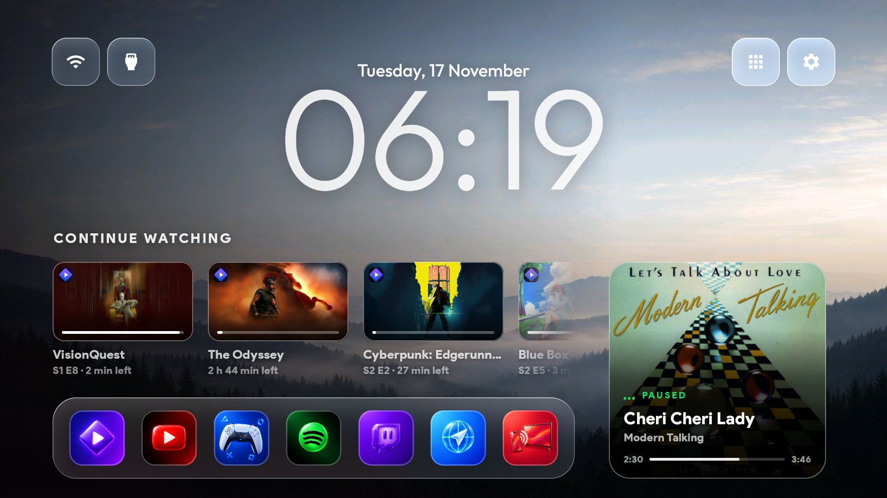
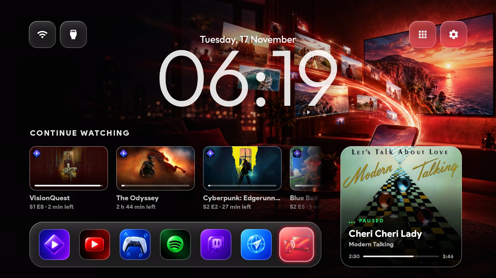

# Lumen



The second theme of this fork of the cleanyourtv launcher, by [ruchira-edirisinghe](https://github.com/ruchira-edirisinghe)
(the first is [Midnight Glass](MIDNIGHT-GLASS.md)). Lumen turns Home into a lock screen: a large time blended into a
wallpaper or the focused app's picture, one line of Continue watching, a seven-app dock and the song card at the
right, which stays up with the last song even when the music has stopped. It is made for a 1080p Google TV GPU, so
everything on it is drawn the cheap way (see [Light on the TV](#light-on-the-tv)).

Tested on a TCL Smart TV Pro (G08, Google TV 14).

## Put it on the TV

Build and install the fork's launcher (`launcher/build-and-install.sh`), then, with ADB connected:

```bash
TV_HOST=<tv ip>:<port> bash my-tv/push-art.sh lumen
```

That sends [`themes/lumen/config.json`](themes/lumen/config.json) (`immersive_home` on, a new wallpaper each day in
order), the wallpapers, the app banners and icons, and any fonts in `fonts/`, then restarts Home. Run it with
`midnight-glass` to switch back; nothing has to be reinstalled either way.

Once after installing, let the launcher see what other apps play, for Continue watching and the song card (it reads
their media sessions, not their notifications):

```bash
adb shell cmd notification allow_listener com.gathin.tvhome/com.gathin.tvhome.WatchListener
```

## The art

| Folder | What it is |
|---|---|
| `wallpapers/*.jpg` | 1920x1080 wallpapers behind Home, one a day, in order (`wallpaper_rotation_minutes` 1440, `wallpaper_order` sequential). Prompts in [`wallpapers/PROMPTS.md`](wallpapers/PROMPTS.md) |
| `heroes/<package>.jpg` | A 1920x1080 picture for each dock app, shown behind everything while that app is focused. Prompts in [`heroes/PROMPTS.md`](heroes/PROMPTS.md) |
| `icons/<package>.png` | A 320x320 glossy icon for each dock tile, from [`icons/gen_icons.py`](icons/gen_icons.py) |

All of it was made with Higgsfield (GPT Image 2.5). To add or replace one picture, put it in the right folder named
after the app's package (`adb shell pm list packages` lists them) and run the script again.

## Home



- **The clock.** The date over a large time in the middle, set in soft white with a gentle shadow over whatever is
  behind it. Wi-Fi and Inputs sit at the top left, Apps and Settings at the top right, as clear glass squares.
- **Nothing selected.** Home starts on the wallpaper with no highlight, only the clock, Continue watching, the dock
  and the song card. Home and Back on Home go back to it.
- **The pictures.** Focusing a dock app or a Continue watching tile puts its picture behind everything; moving on
  crossfades straight from one picture to the next, never through the wallpaper. The shade at the bottom is light, so
  the pictures keep their colour.
- **Continue watching.** One line of small landscape tiles (152x86 dp) with a thin light rim, like the dock's tiles,
  the title and the episode or time left under each. The line scrolls sideways and fades out before the song card;
  Right on the last tile goes to the card.
- **The dock.** Seven apps as glossy squares in one glass band.

## The song card

The song a music app plays (`now_playing`, the apps in `now_playing_apps`, Spotify here) stands at the right as a
square filled by its cover, with the song, the artist and how far in over the bottom of it, a thin rim around it and
44 dp of room between it and Continue watching.

- **It stays.** When the music stops, the card stays with the last song, marked **Paused**. It is kept on the TV, so
  after the TV is switched on Home shows the last song, paused, until something plays.
- **OK** opens the music app.
- **Hold OK** to hide the card. It stays hidden, through restarts, until that music app is opened from Home again;
  then it comes back and stays until it is hidden again.

## The intro

When the TV is switched on, Home fades in the way a phone's lock screen does: the wallpaper rises out of black while
settling from a slight zoom, the date and the time rise into it, the top buttons ease down into place, then Continue
watching, the dock and the song card rise from below, one after another, on long soft curves. Leaving Home part way
through ends it at once, so coming back never shows half an intro.

## Light on the TV

The TV draws Home at 1920x1080 on a small GPU, where every full-screen layer costs a frame's worth of time. So Lumen:

- paints the dark shade into each picture once, as it is loaded, instead of drawing a shade over the screen on every
  frame;
- draws the time in plain blending, not the overlay modes that read the screen back;
- uses no hardware layer for the top fade, no shadows under the tiles and no glass under whole pictures; the rims
  around the tiles and the card are a single stroke;
- loads covers and pictures off the main thread and keeps the decoded ones.

With these, Home went from about a third of its frames late to about a fifth while moving around.

## Live screensaver and fonts

Lumen uses the same live screensaver as Midnight Glass: looping 4K scenes with Lumen's clock and the weather, Continue
watching cards, and the song as a small square card in the bottom right corner. How to get the scenes and switch it
on, and how to use your own fonts, is in the [Midnight Glass guide](MIDNIGHT-GLASS.md#live-screensaver).
