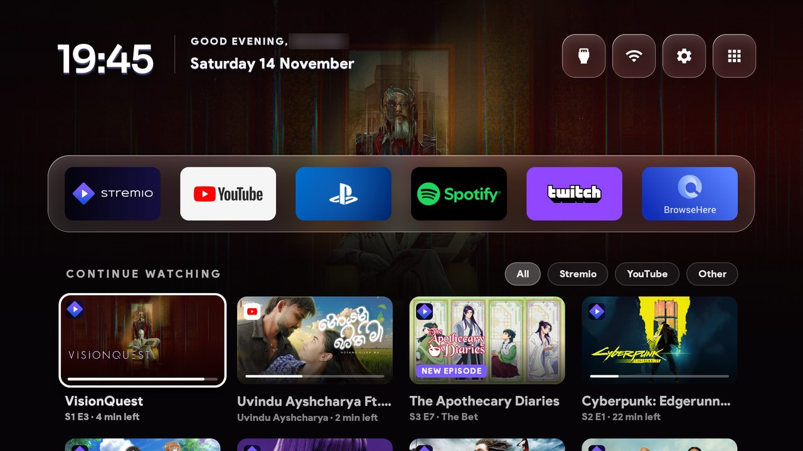
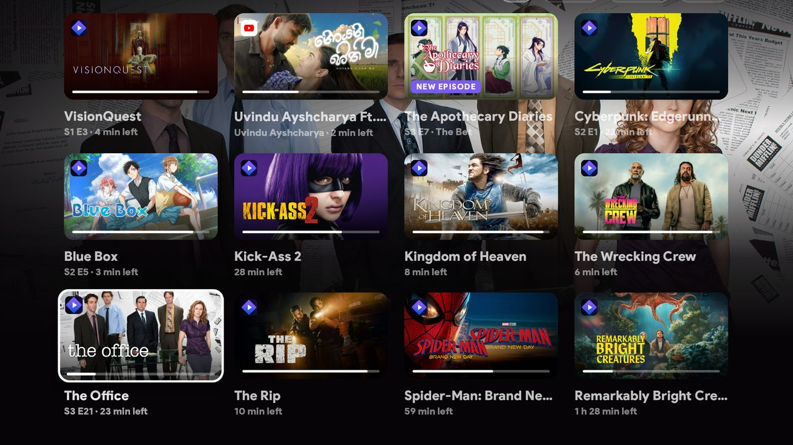
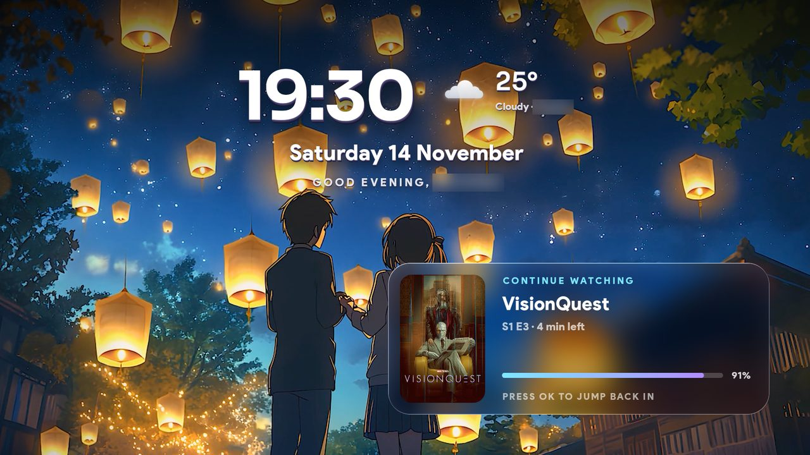
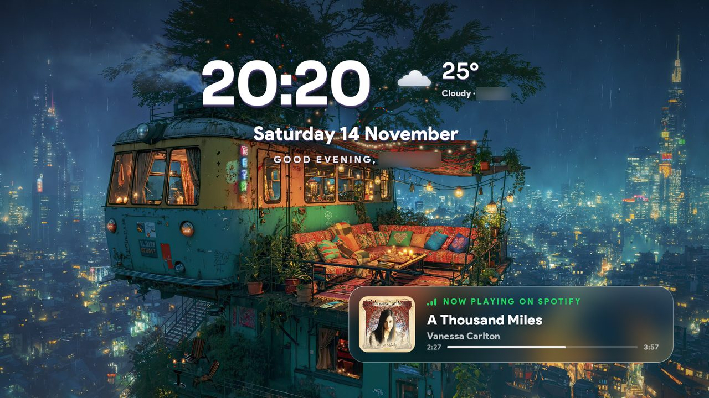

# Midnight Glass


A fork of the cleanyourtv launcher by [ruchira-edirisinghe](https://github.com/ruchira-edirisinghe), made for their
own TV to make everyday watching and working easier: liquid glass, a now playing card for Spotify, Continue watching
banners with filters, a hero banner for every app and a live 4K screensaver that keeps the music going. Anyone can
build it and change it to their liking; everything below says which switch or file does what.

A lighter version that needs no fork, only the main launcher's own settings, is offered to the main repo as the
`midnight-glass` theme.

## My TV's art

The pictures this fork's launcher shows on my TCL Smart TV Pro (G08, Google TV 14). They are not built into the
APK: the launcher reads them from its theme folder on the TV.

| Folder | What it is | Launcher switch |
|---|---|---|
| `heroes/<package>.jpg` | A 1920x1080 banner for each dock app, shown at the top when that app is focused. `input.playstation.jpg` is the PlayStation tile's | `hero_banners` (with `cinematic_home`) |
| `icons/<package>.png` | A 320x320 glossy icon for each app in the grid under the dock; the grid's colour wash is taken from it | `icon_grid`, `grid_glow` |

All of it was made with Higgsfield (GPT Image 2.5). The banner prompts are in [`heroes/PROMPTS.md`](heroes/PROMPTS.md);
the icons come from [`icons/gen_icons.py`](icons/gen_icons.py), which skips any icon that is already there.

## Put it on the TV

With the fork's launcher installed and ADB connected:

```bash
TV_HOST=<tv ip>:<port> bash my-tv/push-art.sh
```

To add or replace one picture, put it in the right folder named after the app's package
(`adb shell pm list packages` lists them) and run the script again. An app with no file keeps its normal artwork.

## Continue watching



Under the dock (`continue_watching`), what was left part-watched as wide banner cards: the title's backdrop with its
logo over it (a YouTube video's own picture), the app's icon, how far in it is, and the name and time left under it.
Stremio's new episodes say so. The cards stand four to a line, as many lines as it takes, and Home scrolls down to
them; Up from the top line goes to the chips, Up again to the dock.

At the right end of the row's name, chips pick what it shows: **All**, **Stremio**, **YouTube** or **Other** (anything
else). A chip filters as soon as it is focused; one with nothing to show says "Nothing here yet".



It fills itself; two things to do once after installing the launcher:

1. Let it see what other apps play (it reads their media sessions, not notifications):

   ```bash
   adb shell cmd notification allow_listener com.gathin.tvhome/com.gathin.tvhome.WatchListener
   ```

   From then on, anything watched for more than a minute in Netflix, YouTube and the like, and not finished, shows
   up with its picture and how far in it is. Spotify and YouTube Music are left out (`continue_skip`).
2. For Stremio's own list and new episodes, open the **Connect Stremio** card in the row, then go to
   link.stremio.com on a phone and enter the code it shows. Only Stremio's key for this TV is kept on the TV.

Hold OK on a card to remove it, or to disconnect Stremio.

## Live screensaver



`LiveSaverDream` plays looping animated 4K scenes (a neon road, cosy pixel-art and candlelit rooms, firefly caves,
lantern skies, anime streets) and dips through black to the next every 75 seconds. Each is shown whole, edge to edge on a 16:9
screen, never cropped. At the top centre, like a tablet's lock screen, stand the time with the weather beside it, the
date, then the greeting with your name, as raised type with a soft shadow and no panel behind it. Every half minute or so a glass card with the poster comes up in
a bottom corner for something left part-watched, or a new Stremio episode. Press OK while a card is up to jump back
into it; any other key ends the screensaver.

It starts after five minutes without a key press, the TV's own screen timeout:
`adb shell settings put system screen_off_timeout 300000` (milliseconds).

The glass cards show a softened copy of the video behind them, refreshed a couple of times a second and only while
a card is up: each copy reads a 4K frame back from the decoder, and doing that all the time made the screensaver
stutter.

Music keeps playing cleanly through the screensaver. On this TV, closing a video player and opening another makes the
sound system move its lip-sync delay (135 ms to none and back), which cut Spotify at every scene change. So the
screensaver keeps one decoder (`ScenePlayer`) for as long as it runs: each scene loops on one clock and the next one
follows on the same decoder, and every scene is 30 fps so the delay never has a reason to move.

The weather (`saver_weather`) comes from [Open-Meteo](https://open-meteo.com/): set `weather_location` to a place
name or `latitude,longitude`, or leave it empty to use the place the TV's internet address points to.

The scenes are not in this repo. They are free 3840x2160 videos from
[Pixabay](https://pixabay.com/service/license-summary/), which may be used but not passed on as files.
[`saver/get-scenes.sh`](saver/get-scenes.sh) downloads them from there, keeps them at 4K without sound, smooths the
loops that would jump, brings every one to 30 fps (25 fps ones play their frames a fifth faster, as 25 judders on the
60 Hz panel; 60 fps ones keep every other frame) and writes them to the TV:

```bash
TV_HOST=<tv ip>:<port> bash my-tv/saver/get-scenes.sh
adb shell settings put secure screensaver_components com.gathin.tvhome/.LiveSaverDream
```

Any other `.mp4`, `.webm` or `.mkv` put in the theme folder's `saver/` joins the rotation.

## Now playing


While Spotify plays (`now_playing`, the apps in `now_playing_apps`), an upright glass card, the cover on top and the
song, the artist and how far in under it, stands on Home on the right, between the four top buttons and the dock and
exactly as wide as the buttons, with the same gap above and below it. The song's whole name shows, over up to three
lines, and the cover takes the height the text leaves. It fades out as soon as the apps scroll and comes back at the
top.



On the live screensaver the card lies down in the bottom right corner, the cover at the left, under a "Now playing
on Spotify" kicker with small dancing bars, one line for the title, and stays still.

While a song plays:

- **The screensaver's Continue watching cards step aside,** and come back when the music stops. Home's row stays.
- **The TV stays awake on the screensaver.** Android would end the screensaver and put the TV to sleep once the sleep
  timeout has passed since the last key, music or not. So while the screensaver shows a song, the launcher sets
  `sleep_timeout` to never and puts your own value back two minutes after the music stops, or as soon as a key ends
  the screensaver. If the launcher died while holding it, Home puts it back when it starts.

It reads the songs with the same listener as Continue watching (`allow_listener ... WatchListener`, above) and changes
the timeout with `WRITE_SECURE_SETTINGS`, both already granted on this TV.

## Liquid glass

`liquid_glass` sets the header as raised type with no panel (the clock, then the greeting over the date), puts the top
buttons in one glass bar with a milky lens on the focused one, and makes the dock band glass too. On Android 13 and
later the glass shows a softened copy of the picture behind it, bent at the edges like a lens, with light along its
rim. The screensaver's cards use the same glass, over the video.

With `top_bar_grid` the top bar's buttons (inputs, network, settings, all apps) are square glass icons at the top
right, all four in one line here (`top_bar_grid_columns`); the greeting and the date get the header's whole width.

Clocks are set in Sora, titles in Fraunces and labels in Space Grotesk (all SIL Open Font License).

On this TV the titles and labels are Product Sans Black instead, all upright (the date too). Product Sans may not be
shared, so it is not in the repo: put the files in `my-tv/fonts/` (git-ignored), named after the string they replace
(`font_title.ttf`, `font_title_italic.ttf` as the upright Black too, `font_label.ttf`, `font_label_bold.ttf`), and `push-art.sh` sends them
to the launcher's theme folder, which uses a font there in place of the bundled one.
