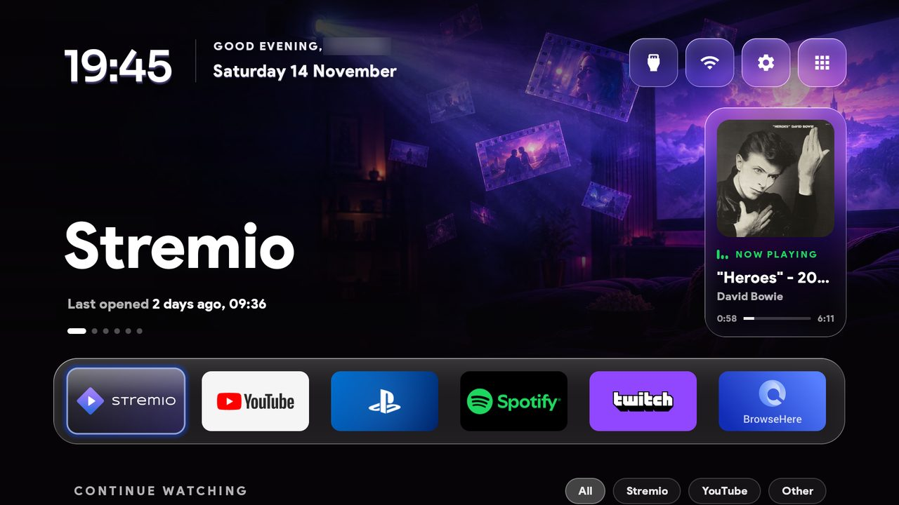

# My TV: two themes

This fork of the cleanyourtv launcher by [ruchira-edirisinghe](https://github.com/ruchira-edirisinghe) comes with two
themes for the same launcher, made for a TCL Smart TV Pro (G08, Google TV 14). Each has its own install guide.

| | Theme | What it is |
|---|---|---|
|  | **[Lumen](LUMEN.md)** | A lock-screen Home: a large time over a daily wallpaper, one line of Continue watching tiles, a seven-app dock and a square song card that keeps the last song, paused. Light on the TV's GPU. |
|  | **[Midnight Glass](MIDNIGHT-GLASS.md)** | Liquid glass: a glass top bar, hero banners for every app, Continue watching banners with filter chips under the dock and an upright now playing card. |

Both use the same build of the launcher, the same app art and the same live 4K screensaver. Switching is one line,
with no reinstall:

```bash
TV_HOST=<tv ip>:<port> bash my-tv/push-art.sh lumen            # or midnight-glass
```

The themes' settings are in [`themes/lumen/config.json`](themes/lumen/config.json) and
[`themes/midnight-glass/config.json`](themes/midnight-glass/config.json); the art they share is in `heroes/`, `icons/`
and `wallpapers/` (Lumen only), and the screensaver's scene downloader is in `saver/`.
